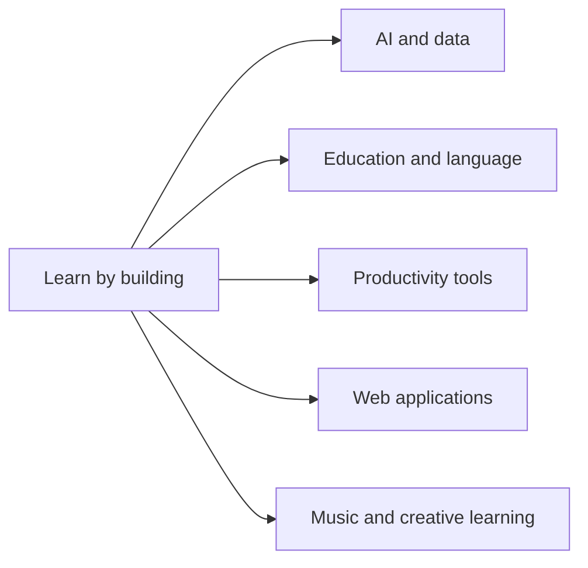

# Hi, I'm Egehan Şahban 👋
### High School Student · Exploring Software Development & AI

I'm a high school student in Türkiye interested in software development and artificial intelligence. I build personal projects to explore new technologies, solve practical problems, and improve my programming skills.

My repositories span AI learning, language education, productivity, data exploration, music, and web applications. Some are experiments; others are tools I’m building around specific needs. Their scope and features continue to evolve.

[Browse all public repositories](https://github.com/Flynntaggart26?tab=repositories) · [Visit my blog](https://egehansahban.blogspot.com/)

---

  

Visual metaphor for learning, data, and connected ideas · <a href="https://unsplash.com/s/photos/data-visualization">Unsplash</a>

## Areas I explore

## Featured projects

### 🤖 AI & machine learning

| Project | About |
|---|---|
| [Learn RAG](https://github.com/Flynntaggart26/learn-rag) | A learning resource for Retrieval-Augmented Generation, its core concepts, and related tools. |
| [How to Learn AI](https://github.com/Flynntaggart26/how-to-learn-ai) | Learning paths and resources for exploring artificial intelligence. |
| [NanoGPT Playground](https://github.com/Flynntaggart26/nanogpt-playground) | A project for exploring small language models and transformer-based text generation. |
| [RAFT Lab](https://github.com/Flynntaggart26/raft-lab) | Experiments and learning materials related to Retrieval-Augmented Fine-Tuning. |

### 📊 Data & research projects

| Project | About |
|---|---|
| [Path to USA Scholarships](https://github.com/Flynntaggart26/path-to-usa-scholarships) | An interactive project for exploring U.S. university costs, financial aid, and scholarship information. |
| [Climate Energy](https://github.com/Flynntaggart26/Climate-energy) | A project exploring climate- and energy-related data. |
| [Image Search Engine](https://github.com/Flynntaggart26/image-search-engine) | An image search application using Python, Streamlit, and the Pexels API. |

### 🎓 Education & language learning

| Project | About |
|---|---|
| [SAT Vocabulary](https://github.com/Flynntaggart26/SAT-Vocabulary) | Vocabulary practice for SAT preparation. |
| [SAT Vocab](https://github.com/Flynntaggart26/sat-vocab) | An offline SAT vocabulary study tool. |
| [SAT Study Tutor](https://github.com/Flynntaggart26/sat-study-tutor) | A curated Digital SAT self-study guide. |
| [SAT Punctuation Masterclass](https://github.com/Flynntaggart26/sat-punctuation-masterclass) | Interactive punctuation and grammar practice for the Digital SAT. |
| [Desmos SAT Guide](https://github.com/Flynntaggart26/desmos-sat-guide) | Desmos strategies and practice material for SAT Math. |
| [IELTS Grammar Studio](https://github.com/Flynntaggart26/ielts-grammar-studio) | IELTS grammar practice and writing support. |
| [IELTS Study Tutor](https://github.com/Flynntaggart26/ielts-study-tutor) | IELTS self-study resources and study planning. |
| [Grammar Mastery](https://github.com/Flynntaggart26/Grammar-mastery) | Interactive English grammar practice. |
| [Context Vocab Saver](https://github.com/Flynntaggart26/context-vocab-saver) | A browser extension for saving English words with their original context and reviewing them later. |
| [Vocabulary Bank](https://github.com/Flynntaggart26/Vocabulary-bank) | Vocabulary learning resources. |
| [PDF Quiz](https://github.com/Flynntaggart26/PDF-quiz) | A project exploring quiz generation from PDF documents. |

### 🛠️ Web applications & practical tools

| Project | About |
|---|---|
| [Virexa.Co](https://github.com/Flynntaggart26/Virexa.Co) | A web development project. |
| [Virexa Yade Premium Menu](https://github.com/Flynntaggart26/virexa-yade.premium-menu) | A digital menu project. |
| [Denizli Guide](https://github.com/Flynntaggart26/denizli-guide) | An interactive guide to places and experiences in Denizli. |
| [Welcome Turkey](https://github.com/Flynntaggart26/welcome-turkey) | A project focused on useful information about Türkiye. |
| [Volunteer Hub](https://github.com/Flynntaggart26/volunteer-hub) | A project related to volunteering and community participation. |
| [Study Planner](https://github.com/Flynntaggart26/planlayici) | A study planner for organizing tasks and study sessions. |
| [Focus Lab](https://github.com/Flynntaggart26/focus-lab) | A project exploring productivity and focus tools. |
| [Calorie Tracker](https://github.com/Flynntaggart26/calorie-tracker) | A browser-based calorie and nutrition tracker. |

### 🎵 Music & creative learning

| Project | About |
|---|---|
| [Ritim Stüdyo](https://github.com/Flynntaggart26/ritim-studyo) | A Turkish-language music studio and booking application. |
| [Bateri Akademisi](https://github.com/Flynntaggart26/bateri-akademisi) | A bilingual drum-learning curriculum with interactive practice tools. |

> GitHub currently shows 37 repositories. This page highlights projects I could identify from my profile and public project descriptions; [the repository page](https://github.com/Flynntaggart26?tab=repositories) has the complete, current list.

## 🧰 Technologies & tools

Technologies I use or explore across my projects:

- **Languages:** Python, JavaScript, TypeScript, HTML, CSS
- **AI and machine learning:** Hugging Face, language models, RAG concepts
- **Data and search:** Pandas, NumPy, embeddings, information retrieval
- **Web development:** Streamlit and browser-based applications
- **Tools:** Git, GitHub, Jupyter Notebook

<strong>How I learn</strong>

I learn by building, testing, researching, and improving. When I encounter a problem, I try to understand the underlying concept and explore different ways to solve it. These repositories reflect that ongoing process, so their scope, features, and implementations may change as I continue developing them.

## 🌱 What I’m exploring

- Building educational tools that make learning more interactive.
- Exploring AI and language-model applications through practical experiments.
- Developing web applications around everyday problems.
- Improving my programming, debugging, and project-planning skills.

## 📖 Personal blog

I also write about experiences, learning, and personal growth on [APEX CURRENT](https://egehansahban.blogspot.com/).

---

Thanks for visiting — I’m learning by building, one project at a time.

